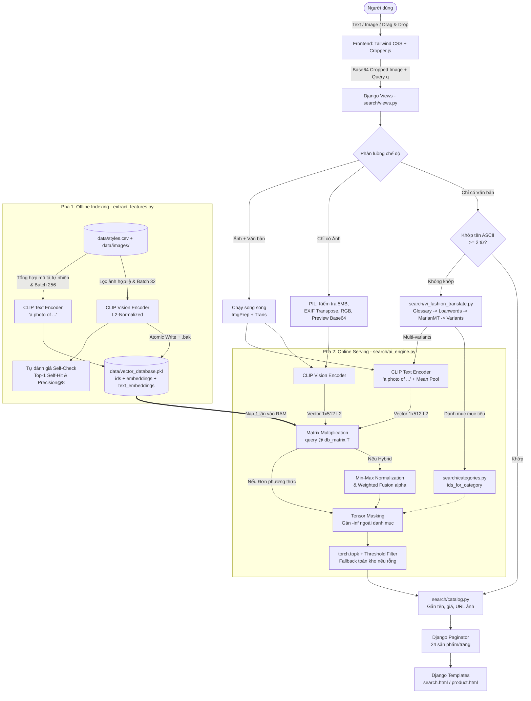

# 👗 AI Fashion Search — Multimodal E-Commerce Search Engine & Vector Pipeline


**AI Fashion Search** là hệ thống tìm kiếm sản phẩm thời trang đa phương thức (**Multimodal Search Engine**) hoạt động hoàn toàn theo kiến trúc **Offline-first**. Repository này hợp nhất trọn vẹn cả hai thành phần trong cùng một mã nguồn và một môi trường cài đặt duy nhất:

1. **Offline Vector Extraction Pipeline (`extract_features.py`):** Trích xuất đặc trưng hình ảnh & mô tả sản phẩm theo lô bằng mô hình **CLIP (`openai/clip-vit-base-patch32`)**, xây dựng cơ sở dữ liệu vector an toàn và tự động đánh giá chất lượng bằng **Precision@8**.
2. **Online Multimodal Web Application (`search/` — Django):** Giao diện cửa hàng thời trang hỗ trợ 4 chế độ tìm kiếm (**Văn bản tiếng Việt**, **Hình ảnh có cắt vùng**, **Tìm kiếm lai Ảnh + Chữ**, **Gợi ý sản phẩm tương tự**) cùng hệ thống duyệt danh mục đa chiều.

> **Tác giả:** Bùi Mạnh Huy  
> **Mục tiêu:** Đồ án xây dựng hệ thống tìm kiếm tương đồng đa phương thức ứng dụng thực tế cho thương mại điện tử thời trang.

---

## 📑 Mục lục

1. [Bài toán & Giải pháp](#-bài-toán--giải-pháp)
2. [Tính năng chính](#-tính-năng-chính)
3. [Kiến trúc hệ thống (2 Pha)](#-kiến-trúc-hệ-thống-2-pha)
4. [Phân tích chuyên sâu các điểm nhấn kỹ thuật](#-phân-tích-chuyên-sâu-các-điểm-nhấn-kỹ-thuật)
5. [Công nghệ sử dụng (Tech Stack)](#-công-nghệ-sử-dụng-tech-stack)
6. [Cấu trúc thư mục hợp nhất](#-cấu-trúc-thư-mục-hợp-nhất)
7. [Cấu hình & Tham số hệ thống](#-cấu-hình--tham-số-hệ-thống)
8. [Hướng dẫn cài đặt & Khởi chạy (Dùng chung cho cả Web & Trích xuất)](#-hướng-dẫn-cài-đặt--khởi-chạy-dùng-chung-cho-cả-web--trích-xuất)
9. [Định hướng nâng cấp (Future Roadmap)](#-định-hướng-nâng-cấp-future-roadmap)

---

## 🎯 Bài toán & Giải pháp

Trong thương mại điện tử thời trang, tìm kiếm truyền thống dựa trên khớp từ khóa (Keyword Matching) gặp nhiều giới hạn: người dùng khó gọi đúng tên sản phẩm, thường muốn tìm qua ảnh chụp thực tế hoặc mô tả kết hợp kiểu *"một chiếc áo giống ảnh này nhưng màu đen, tay dài"*. Bên cạnh đó, mô hình đa phương thức **CLIP** đạt hiệu suất tốt nhất trên tiếng Anh và dễ sai lệch khi gặp thuật ngữ thời trang Việt Nam (như *quần bò, áo form rộng, dép quai ngang*).

**AI Fashion Search** giải quyết đồng bộ từ khâu chuẩn bị dữ liệu đến khâu phục vụ người dùng:

* **Đồng bộ tuyệt đối không gian vector (Indexing–Serving Parity):** Pipeline trích xuất (`extract_features.py`) và bộ máy tìm kiếm (`ai_engine.py`) dùng chung mô hình, chung nhánh projection, chuẩn hóa $L_2$ và khuôn mẫu prompt `"a photo of {}"`.
* **Bộ dịch chuyên ngành thời trang lai:** Kết hợp từ điển thời trang (*Glossary-first*), bảo toàn từ mượn (*Loanwords*), mô hình dịch máy cục bộ (**MarianMT**) và mở rộng truy vấn đa biến thể (*Query Expansion*).
* **Khắc phục lệch thang điểm trong Tìm kiếm Lai (*Modality Gap*):** Áp dụng chuẩn hóa **Min-Max Normalization** độc lập cho phân phối điểm Ảnh và Văn bản trước khi trộn trọng số $\alpha$.
* **Tối ưu UX khoanh vùng sản phẩm:** Tích hợp **Cropper.js** cho phép cắt riêng món đồ cần tìm ngay trên trình duyệt mà không tự gửi form sớm, tạo điều kiện kết hợp thêm mô tả văn bản.

---

## ✨ Tính năng chính

### A. Ứng dụng Web Tìm Kiếm (Online Serving)

* **Tìm kiếm bằng văn bản tiếng Việt (Text-to-Image):**
  * Tự động ưu tiên khớp chính xác tên sản phẩm đối với truy vấn tiếng Anh/ASCII từ 2 từ trở lên (ví dụ: `Puma Men Red Slipper`).
  * Với truy vấn tiếng Việt, hệ thống tự động dịch sang ngữ cảnh thời trang tiếng Anh, hiển thị câu đã dịch và xếp hạng sản phẩm theo độ tương đồng ngữ nghĩa.
* **Tìm kiếm bằng hình ảnh (Image-to-Image):**
  * Hỗ trợ kéo-thả (*Drag & Drop*) trên trang chủ hoặc chọn ảnh trực tiếp trên thanh Header ở mọi trang.
  * Khoanh vùng món đồ bằng **Cropper.js**, tự động sửa xoay ảnh điện thoại (EXIF) và hiển thị ảnh xem trước Base64 trực tiếp trong RAM.
* **Tìm kiếm lai — Vector Fusion (Hybrid Search):**
  * Kết hợp hình ảnh đã cắt và từ khóa mô tả bổ sung (ví dụ: tải ảnh đôi giày + nhập *"màu trắng cổ cao"*).
* **Gợi ý sản phẩm tương tự (Visual Similarity):**
  * Trên trang chi tiết (`/product/<id>/`), truy xuất tức thì các sản phẩm giống nhất bằng vector đã nạp sẵn trong RAM ($O(1)$ lookup).
* **Duyệt danh mục & Bộ lọc đa chiều (Faceted Browsing):**
  * Thanh menu 5 nhóm (**Nam**, **Nữ**, **Trẻ em**, **Giày dép**, **Phụ kiện**) kèm top 8 loại sản phẩm phổ biến nhất.
  * Trang danh mục (`/category/`) lọc chéo theo **Loại sản phẩm** (`articleType`) và **Màu sắc** (`baseColour`, có chấm màu trực quan), cập nhật số lượng thực tế và phân trang 24 sản phẩm/trang.

### B. Pipeline Trích Xuất & Kiểm Định Dữ Liệu (Offline Indexing)

* **Trích xuất theo lô tốc độ cao:** Tự động tận dụng CUDA GPU (hoặc CPU), xử lý song song theo batch (`BATCH_SIZE = 32` cho ảnh, `256` cho văn bản) kèm thanh tiến trình `tqdm`.
* **Chống lệch ID & Chịu lỗi ảnh hỏng:** Bỏ qua ảnh thiếu/hỏng một cách an toàn và loại bỏ đồng thời cả `id` lẫn vector, đảm bảo ma trận luôn khớp 1-1.
* **Lưu trữ nguyên tử & Sao lưu tự động:** Tự động tạo bản sao `.bak` cho Vector DB cũ và ghi file mới qua tệp tạm `.tmp` + `os.replace`.
* **Tự kiểm định chất lượng (Self-Evaluation):** Ngay sau khi trích xuất xong, script tự lấy mẫu $n = 300$ truy vấn ảnh để đo **Top-1 Self-Hit** và **Precision@8** theo nhóm, loại sản phẩm và màu sắc.

> 📸 **Gợi ý trình bày:** *(Chụp 3 ảnh giao diện: Trang chủ Dropzone, Modal cắt ảnh Cropper.js và Trang kết quả Hybrid Search, lưu vào thư mục `docs/` rồi chèn vào đây để nhà tuyển dụng xem trực quan ngay khi mở repo).*

---

## 🏗️ Kiến trúc hệ thống (2 Pha)



---

## 🧠 Phân tích chuyên sâu các điểm nhấn kỹ thuật

### 1. Pipeline trích xuất đặc trưng an toàn & Tự đánh giá (`extract_features.py`)

* **Toàn vẹn dữ liệu tuyệt đối:** Ảnh hỏng/lỗi đọc bị loại bỏ cùng lúc cả mã `id` và đặc trưng ảnh trong vòng lặp lô, kiểm chứng chặt bằng `assert emb.shape[0] == len(ids) == len(kept)`.
* **Trích xuất song song vector mô tả (Dual-Embedding Metadata):** Tự động tổng hợp câu mô tả tiếng Anh từ các cột nhãn (`baseColour`, `articleType`, `gender`, `usage` — lọc bỏ nhãn `"casual"` quá chung) và mã hóa thành `text_embeddings` lưu cùng `embeddings` trong `vector_database.pkl`.
* **Ghi tệp nguyên tử (Atomic Write):** Sao lưu file cũ thành `.bak`, xuất dữ liệu vào `.tmp` rồi dùng `os.replace` để tránh hỏng dữ liệu khi mất điện hoặc ngắt tiến trình đột ngột.
* **Kiểm định định lượng (`self_check`):** Lấy mẫu $n = 300$ sản phẩm để kiểm tra:
  * **Top-1 Self-Retrieval Rate** (kỳ vọng $\approx 100\%$, phát hiện tức thì lỗi lệch ID).
  * **Precision@8** ở 3 cấp độ: cùng nhóm (`subCategory`), cùng loại (`articleType`) và cùng màu (`baseColour`).

### 2. Truy xuất vector hiệu năng cao bằng đại số tuyến tính (`search/ai_engine.py`)

* Khi khởi động máy chủ, toàn bộ ma trận vector trong `data/vector_database.pkl` được nạp vào RAM và chuẩn hóa $L_2$ một lần duy nhất:
  $$\hat{v}_i = \frac{v_i}{\|v_i\|_2}, \quad \hat{q} = \frac{q}{\|q\|_2}$$
* Phép tính Cosine Similarity giữa truy vấn $\hat{q} \in \mathbb{R}^{1 \times 512}$ và toàn kho $M \in \mathbb{R}^{N \times 512}$ rút gọn thành một phép nhân ma trận trên PyTorch (`query_features @ db_matrix.T`).
* Duy trì bảng băm `_id_to_index` ($O(1)$) cho tính năng *"Sản phẩm tương tự"*, tái sử dụng vector đã có mà không cần chạy lại Vision Encoder, đồng thời loại chính sản phẩm đang xem qua `exclude_id`.

### 3. Giải quyết bài toán "Modality Gap" trong Tìm kiếm Lai (`rank_hybrid`)

* **Vấn đề:** Trong không gian CLIP, điểm Cosine **Ảnh–Ảnh** thường nằm ở khoảng $0.7\text{--}1.0$, trong khi **Văn bản–Ảnh** chỉ quanh $0.2\text{--}0.3$. Cộng trực tiếp vector sẽ khiến ảnh lấn át hoàn toàn văn bản.
* **Giải pháp:** Chuẩn hóa độc lập hai phân phối điểm trên toàn kho về cùng thang đo $[0, 1]$ bằng **Min-Max Normalization** trước khi kết hợp theo trọng số $\alpha = 0.5$:
  $$\text{MinMax}(S) = \frac{S - \min(S)}{\max(S) - \min(S) + 10^{-8}}$$
  $$S_{\text{hybrid}} = \alpha \cdot \text{MinMax}(S_{\text{img}}) + (1 - \alpha) \cdot \text{MinMax}(S_{\text{txt}})$$

### 4. Bộ dịch thời trang lai: Glossary-First + Neural MT + Query Expansion (`search/vi_fashion_translate.py`)

1. **Khớp cụm dài nhất không phân biệt dấu (Longest-Match-First):** Chuẩn hóa Unicode NFD (`đ -> d`, bỏ dấu) và khớp trên từ điển chuyên ngành `GLOSSARY` hơn 200 cụm từ (Áo, Quần, Váy/Đầm, Giày, Dép/Phụ kiện, Màu sắc, Chất liệu, Kiểu dáng).
2. **Bảo toàn từ mượn & Khử nhập nhằng ngữ cảnh:** Giữ nguyên các từ mượn thời trang (`LOANWORDS` như *hoodie, bomber, jogger, oversize, croptop...*). Tự động phân biệt từ đa nghĩa theo ngữ cảnh danh mục (ví dụ: *"cổ cao/thấp"* chuyển thành `high-neck`/`low-neck` cho *Áo* thay vì `high-top`/`low-top` của *Giày*).
3. **MarianMT Offline Fallback & Caching:** Chỉ đưa những đoạn từ **chưa có trong từ điển** sang mô hình `MarianMTModel` (`num_beams=4`, `max_new_tokens=64`), bỏ qua chuỗi không có dấu tiếng Việt bằng regex `_VI_CHARS`, kết hợp `@lru_cache(maxsize=512)` để tối ưu truy vấn lặp lại.
4. **Mở rộng truy vấn (Multi-Variant Ensembling):** Tự động sinh các biến thể đồng nghĩa qua `VARIANTS` (ví dụ: `sneakers` $\rightarrow$ `["sneakers", "athletic shoes", "running shoes"]`), bọc prompt `"a photo of {}"`, mã hóa rồi lấy trung bình vector chuẩn hóa $L_2$.

### 5. Lọc danh mục bằng Tensor Masking & Kiến trúc tách lớp

* **Tensor Masking & Fallback:** Suy luận danh mục mục tiêu (`Áo`, `Quần`, `Giày`, `Dép`), ánh xạ sang tập `articleType` (`categories.py`) và gán $-\infty$ cho các sản phẩm ngoài danh mục trước khi gọi `torch.topk`. Nếu kết quả rỗng, tự động fallback tìm toàn kho.
* **Tách lớp dữ liệu (`catalog.py`):** Cô lập hoàn toàn việc đọc CSV, chuẩn hóa ID (`_normalize_id`), tự dò thư mục ảnh và khớp tên trực tiếp (`search_by_name`) khỏi AI Engine, sẵn sàng chuyển sang PostgreSQL/MySQL mà không cần sửa logic AI.
* **Xử lý ảnh trong RAM & Cropper.js UX (`base.html`, `home.html`, `views.py`):** Cắt và nén ảnh trên Client về tối đa $1024 \times 1024$ (Base64 JPEG), phát sự kiện `cropchange` đồng bộ trạng thái giữa Header và Hero Dropzone mà không tự submit form; phía Server kiểm tra giới hạn `5MB`, bắt `DecompressionBombError`, sửa xoay EXIF và tạo thumbnail Base64 trong `io.BytesIO`.

---

## 🛠️ Công nghệ sử dụng (Tech Stack)

| Thành phần | Công nghệ / Thư viện | Vai trò trong hệ thống |
| :--- | :--- | :--- |
| **Backend Framework** | Python, Django (MVT) | Điều phối Request/Response, định tuyến URL, phân trang, Context Processors |
| **Deep Learning / Vision** | PyTorch, Hugging Face `CLIPModel` (`openai/clip-vit-base-patch32`) | Trích xuất vector theo lô (Offline) & Mã hóa truy vấn / tính Cosine (Online) |
| **NLP / Translation** | Hugging Face `MarianMTModel`, `sentencepiece`, Custom Glossary | Dịch máy cục bộ Việt $\rightarrow$ Anh kết hợp từ điển thời trang & mở rộng truy vấn |
| **Data & Image Processing** | NumPy, Pandas, Pillow (PIL), Pickle, `tqdm` | Đọc metadata CSV, lưu trữ & nạp ma trận `.pkl`, xử lý ảnh EXIF/Base64, thanh tiến trình |
| **Frontend & Interaction** | Django Templates, Tailwind CSS, Vanilla JS, Cropper.js (`1.5.13`), Font Awesome | Giao diện Responsive, Drag & Drop, khoanh vùng cắt ảnh, đồng bộ Hybrid Search |

---

## 📂 Cấu trúc thư mục hợp nhất

Toàn bộ mã nguồn Web App và Pipeline trích xuất được đặt trong **một repository duy nhất**, dùng chung thư mục `data/`, `clip_model/` và một file `requirements.txt`:

```text
ai-fashion-search/
├── README.md                        # Tài liệu tổng quan & hướng dẫn sử dụng
├── .gitignore                       # Chặn đẩy môi trường ảo, dataset và trọng số model lên Git
├── requirements.txt                 # Bộ thư viện dùng chung cho cả Web App và Trích xuất vector
├── manage.py                        # Điểm khởi chạy lệnh quản trị Django
├── extract_features.py              # Pipeline trích xuất vector CLIP theo lô & tự kiểm định Precision@8
├── search/                          # Ứng dụng Django lõi
│   ├── ai_engine.py                 # Nạp CLIP & MarianMT offline, Vector DB, Cosine/Hybrid Ranking & Tensor Masking
│   ├── vi_fashion_translate.py      # Bộ dịch lai thời trang (Glossary, Loanwords, Disambiguation, Query Expansion)
│   ├── catalog.py                   # Lớp dữ liệu sản phẩm (CSV, tự dò ảnh, tìm theo tên ASCII)
│   ├── categories.py                # Quản lý cây danh mục, bộ lọc đa chiều & ánh xạ danh mục AI
│   ├── views.py                     # Điều phối 4 luồng tìm kiếm, giải mã ảnh Base64/EXIF & phân trang
│   ├── context_processors.py        # Cấp biến `nav_groups` dùng chung cho mọi template
│   ├── urls.py                      # Định tuyến: /, /search/, /category/, /product/<id>/
│   ├── apps.py                      # Cấu hình SearchConfig
│   └── templates/                   # Giao diện người dùng (Django Templates + Tailwind CSS)
│       ├── base.html                # Layout khung, Header search, Mega-menu, Modal Cropper.js & Loading Overlay
│       ├── home.html                # Trang chủ: Hero Search + Dropzone kéo-thả ảnh, Ô danh mục & Gợi ý
│       ├── search.html              # Trang kết quả hiển thị riêng biệt 3 chế độ (Text / Image / Hybrid)
│       ├── category.html            # Trang danh mục: Breadcrumb, Sidebar lọc Loại/Màu & Phân trang
│       ├── product.html             # Trang chi tiết & Lưới "Có thể bạn cũng thích" (Visual Similarity)
│       └── product_card.html        # Component thẻ sản phẩm kèm thanh phần trăm Độ tương đồng
├── data/                            # [Không đẩy lên Git] images/, styles.csv (hoặc dataset_mini.csv), vector_database.pkl
├── clip_model/                      # [Không đẩy lên Git] Trọng số mô hình CLIP cục bộ
└── translator_model/                # [Không đẩy lên Git] Trọng số mô hình dịch MarianMT cục bộ
```

---

## ⚙️ Cấu hình & Tham số hệ thống

| Tham số | File khai báo | Mặc định | Mô tả |
| :--- | :--- | :--- | :--- |
| `BATCH_SIZE` | `extract_features.py` | `32` | Số ảnh xử lý song song mỗi lô khi trích xuất vector (mô tả chữ dùng lô `256`) |
| `TOP_K` | `search/ai_engine.py` | `20` | Số lượng sản phẩm tối đa AI trả về cho mỗi truy vấn |
| `TEXT_MIN_SCORE` | `search/ai_engine.py` | `0.15` | Ngưỡng Cosine Similarity tối thiểu cho tìm kiếm bằng văn bản |
| `IMAGE_MIN_SCORE` | `search/ai_engine.py` | `0.15` | Ngưỡng Cosine Similarity tối thiểu cho tìm kiếm bằng hình ảnh |
| `HYBRID_ALPHA` | `search/ai_engine.py` | `0.5` | Trọng số tìm kiếm lai ($1.0$: thuần ảnh, $0.0$: thuần văn bản) |
| `PROMPT_TEMPLATE` | `search/ai_engine.py` | `"a photo of {}"` | Khuôn mẫu ngữ cảnh dùng chung cho cả Indexing (`extract_features.py`) và Serving |
| `MAX_UPLOAD_MB` | `search/views.py` | `5` | Giới hạn dung lượng ảnh tải lên tối đa (MB) |
| `PAGE_SIZE` | `search/views.py` | `24` | Số sản phẩm hiển thị trên mỗi trang kết quả / danh mục |
| `USE_TRANSLATOR` | `settings.py` *(tùy chọn)* | `True` | Bật/tắt bộ dịch Việt $\rightarrow$ Anh trước khi đưa vào CLIP |
| `FASHION_IMAGE_DIR` / `FASHION_CSV` | `settings.py` *(tùy chọn)* | *Tự động dò* | Chỉ định thủ công đường dẫn thư mục ảnh và file CSV nếu cần |

---

## 🚀 Hướng dẫn cài đặt & Khởi chạy (Dùng chung cho cả Web & Trích xuất)

### Yêu cầu môi trường
* **Python 3.10+**
* **RAM:** Khuyến nghị tối thiểu 8GB (hệ thống tự động tận dụng **CUDA GPU** nếu có, hoặc chạy ổn định trên **CPU**).

### Bước 1: Clone mã nguồn
```bash
git clone https://github.com/<username>/ai-fashion-search.git
cd ai-fashion-search
```

### Bước 2: Tải dữ liệu & Mô hình AI (Offline-first)
Do giới hạn dung lượng tệp lớn trên GitHub, bộ dữ liệu ảnh, cơ sở dữ liệu vector và trọng số mô hình AI được lưu trữ riêng:

1. Truy cập Google Drive: [**Tải dữ liệu & Mô hình AI tại đây**](https://drive.google.com/drive/folders/1nkstKQ9ODT2H7JZK9qZDPCZSiTHCaUWC?usp=sharing)
2. Tải và giải nén 3 thư mục:
   * `data/` (chứa thư mục ảnh sản phẩm, file CSV metadata và `vector_database.pkl`)
   * `clip_model/` (trọng số mô hình CLIP cục bộ)
   * `translator_model/` (trọng số mô hình dịch MarianMT cục bộ)
3. Đặt cả 3 thư mục này vào **thư mục gốc của dự án** (ngang hàng với `manage.py` và `extract_features.py`).

### Bước 3: Thiết lập 1 môi trường ảo duy nhất & Cài đặt đầy đủ thư viện
Một lần cài đặt duy nhất đáp ứng đầy đủ cả **Web Server (Django)** lẫn **Script trích xuất vector (`extract_features.py`)**:

```bash
# 1. Tạo môi trường ảo
python -m venv env_web

# 2. Kích hoạt môi trường ảo
# Trên Windows (PowerShell / CMD):
.\env_web\Scripts\activate
# Trên macOS / Linux:
source env_web/bin/activate

# 3. Cài đặt toàn bộ thư viện lõi (Django, PyTorch, Transformers, SentencePiece, Pillow, Pandas, NumPy, tqdm)
pip install -r requirements.txt
```

---

### Luồng 1: Chạy trực tiếp Web App (Sử dụng `vector_database.pkl` có sẵn)

```bash
python manage.py runserver --noreload
```

> ⚠️ **Lưu ý kỹ thuật quan trọng:** Bắt buộc dùng cờ `--noreload` khi khởi chạy. Cờ này ngăn bộ theo dõi tự động (autoreloader) của Django tạo 2 tiến trình song song, giúp mô hình CLIP và MarianMT chỉ nạp vào RAM **đúng 1 lần**, rút ngắn thời gian khởi động và chống tràn bộ nhớ.

Mở trình duyệt và truy cập: **`http://127.0.0.1:8000/`**

---

### Luồng 2: Tự trích xuất lại Vector Database từ tập ảnh mới (`extract_features.py`)

Chạy bước này khi bạn thay đổi bộ dữ liệu trong `data/styles.csv` và `data/images/`, hoặc muốn tự tái tạo và kiểm định `data/vector_database.pkl`:

```bash
python extract_features.py
```

Script sẽ tự động:
1. Kiểm tra đối chiếu CSV với thư mục ảnh và loại bỏ các bản ghi thiếu/hỏng ảnh.
2. Mã hóa toàn bộ ảnh (`BATCH_SIZE = 32`) và mô tả sản phẩm (`batch = 256`) bằng CLIP cục bộ trong `clip_model/`.
3. Sao lưu `data/vector_database.pkl` cũ sang `.bak` và ghi file mới an toàn bằng `os.replace`.
4. Chạy tự đánh giá **Self-Check** ($n = 300$, $k = 8$) và in báo cáo `Self-Hit` cùng `Precision@8` ra Terminal.

Sau khi trích xuất xong, chạy lại lệnh ở **Luồng 1** để máy chủ nạp cơ sở dữ liệu vector mới. Khi dừng máy chủ, nhấn `Ctrl + C` và gõ `deactivate` để thoát môi trường ảo.

---

## 🗺️ Định hướng nâng cấp (Future Roadmap)

- [ ] **Khai thác `text_embeddings` đã trích xuất sẵn:** Kết hợp điểm tương đồng truy vấn văn bản với cả vector ảnh (`embeddings`) và vector mô tả metadata (`text_embeddings`) trong `ai_engine.py`.
- [ ] **Tối ưu truy xuất quy mô lớn (ANN Search):** Chuyển từ phép nhân ma trận vét cạn sang **FAISS** hoặc **Qdrant / Milvus** để phục vụ hàng triệu sản phẩm với độ trễ mili-giây.
- [ ] **Nâng cấp tầng dữ liệu sang RDBMS:** Triển khai Django ORM / PostgreSQL thay thế file CSV trong `catalog.py`, bổ sung Giỏ hàng, Yêu thích và Tài khoản người dùng.
- [ ] **Kiểm thử tự động:** Bổ sung Unit Tests (`search/tests.py`) cho pipeline dịch thuật, chuẩn hóa Min-Max và các luồng tìm kiếm.
- [ ] **Đóng gói triển khai:** Viết `Dockerfile` & `docker-compose.yml` chạy Gunicorn (1 worker + preload model) cho môi trường Production.

---

## 📄 Giấy phép & Liên hệ

Dự án được phát triển phục vụ mục đích học tập, nghiên cứu và xây dựng hồ sơ năng lực kỹ sư phần mềm / AI.

* **Tác giả:** Bùi Mạnh Huy
- **Liên hệ:** [GitHub](https://github.com/buimanhhuy0101-create) | [Email](mailto:buimanhhuy0101@gmail.com)